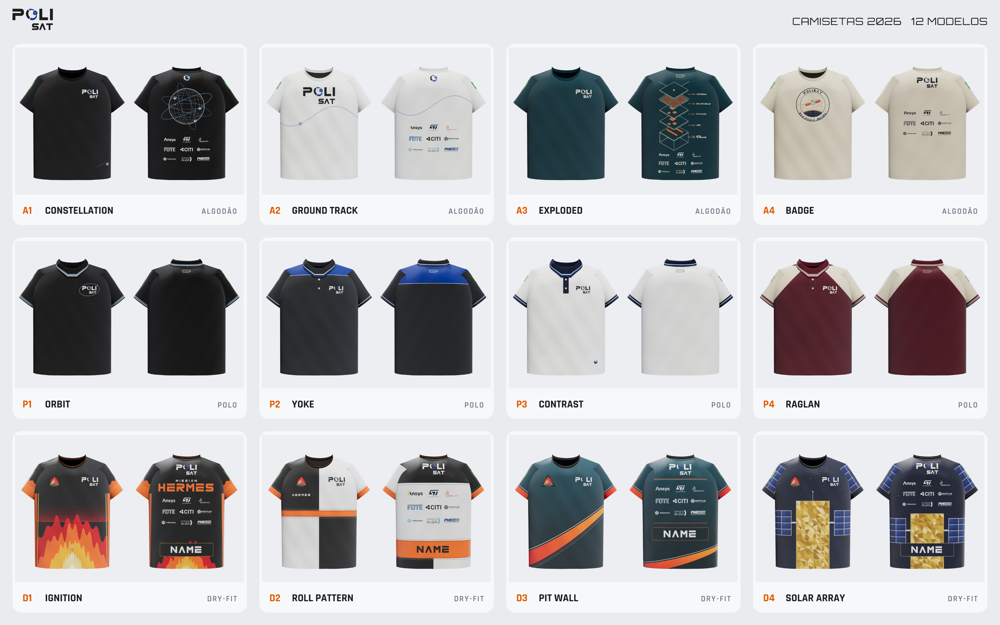

# PoliSat — Camisetas 2026

Dezesseis modelos prontos para a gráfica: **5 polos**, **5 de algodão** e **6 dry-fit**. Todos foram feitos no tamanho M e
estão em escala 1:1.



## Visualizador 3D

O site publicado fica em **<https://polisat-org.github.io/camisetas-3d/>**, no repositório público
[`polisat-org/camisetas-3d`](https://github.com/polisat-org/camisetas-3d). O README de lá explica como acessar,
usar, modificar uma camisa e republicar.

Para conferir localmente, abra `visualizador_3d/index.html` no navegador. Essa pasta é gerada pelo `build.py`.
Depois de mudar um design, copie `index.html`, `dados.js` e a pasta `downloads/` para o repositório `camisetas-3d` e faça push.

No site, cada modelo tem o botão **Baixar XX (ZIP)**, com o pacote completo para a gráfica: `LEIA-ME.txt`, a ficha
técnica, a pasta `impressao/` e os mockups. Os ZIPs são gerados por `_fonte/pacotes.py` em
`visualizador_3d/downloads/`. Essa pasta não entra no git deste repositório, só no `camisetas-3d`.

## Modelos

| ID | Modelo | Tecido / cor | Técnica | Patrocinadores | Missão |
|---|---|---|---|---|---|
| P1 | Orbit | Piquet preto, anel orbital bordado em prata em volta do logo | Bordado | — | — |
| P2 | Yoke | Piquet grafite com pala azul PoliSat nos ombros e vivo branco | Bordado + recorte | — | — |
| P3 | Contrast | Piquet branco, gola/carcela/punhos marinho, CubeSat bordado na barra | Bordado | — | — |
| P4 | Raglan | Piquet vinho com mangas raglan areia | Bordado + recorte | — | — |
| P5 | Flight Crew | Piquet azul royal com recortes laterais marinho e CubeSat bordado nas costas | Bordado + recorte | — | — |
| A1 | Constellation | Algodão 30.1 preto: globo com 3 órbitas e CubeSats nas costas | Silk / DTF | Costas (branco) | — |
| A2 | Ground Track | Algodão 30.1 branco (mantida) | Silk + DTF | Costas (cor) | — |
| A3 | Exploded | Algodão 30.1 azul petróleo: vista explodida de um CubeSat 1U | Silk / DTF | Costas (creme) | — |
| A4 | Badge | Algodão 30.1 areia: emblema vintage de agência espacial | Silk / DTF | Costas (marinho) | — |
| A5 | Varsity | Algodão 30.1 roxo: POLISAT em arco, CUBESAT TEAM, CubeSat 1U com subsistemas nas costas | Silk / DTF | Costas (branco) | — |
| D1 | Telemetry | Azul elétrico com o trem de pulsos de uma mensagem ADS-B real (1090 MHz) e painéis laterais | Sublimação | Costas | Hermes |
| D2 | Roll Pattern | Padrão de rolagem preto/branco de foguete + interestágio laranja | Sublimação | Costas (cor) | Hermes |
| D3 | Pit Wall | Petróleo com curva laranja estilo livery de Fórmula 1 | Sublimação | Costas | Hermes |
| D4 | Solar Array | Azul-noite: corpo em manta térmica dourada e painéis solares | Sublimação | Costas | Hermes |
| D5 | Deploy | Roxo: CubeSat sendo ejetado do deployer, com trilhos e linhas de velocidade | Sublimação | Costas | Hermes |
| D6 | Livery | Branco com blocos angulados vermelho, laranja e preto (estilo equipe de corrida / baja) | Sublimação | Costas (cor) | Hermes |

**Paleta 2026:** além de preto, branco e azul PoliSat, os modelos usam grafite `#2D3035`, vinho `#5B1E2B`,
areia `#D8CCB1`, azul petróleo `#123C45`, azul royal `#1F4AA8` e roxo `#3A2463` nos tecidos. Nas tintas entram azul-céu `#6FB7FF`, creme `#EFE6D2`,
laranja `#E8611A`, marinho `#16213A`, dourado `#D9A520`, lilás `#C7B4FF` e ciano `#38D6FF`.

- **Polos e algodão** são atemporais. Levam só os logos da PoliSat, da USP e da Poli e a bandeira do Brasil,
  sem nada da missão. As polos não têm patrocinadores.
- **Dry-fit** são as camisetas da missão Hermes: patch no peito e patrocinadores nas costas. O fim das costas
  é reservado para o **nome** de cada pessoa.
- Todos os textos estão em inglês ("MISSION HERMES", "NAME") e na fonte **ND Logos**, já convertidos em curvas.

## O que levar para a gráfica

Cada pasta em `modelos/<modelo>/` tem:

| Arquivo | Conteúdo |
|---|---|
| `ficha_tecnica_XX.pdf` / `.png` | Ficha técnica A3: vistas com as cotas, tabela de aplicações (tamanho, posição em relação ao HPS, técnica, cores Pantone), tecido, acabamento e observações |
| `impressao/*.svg` + `*.pdf` | **Arquivos de produção** vetoriais em escala 1:1 |
| `mockup_XX_frente/costas/lado.png` | Mockups 3D para aprovação |
| `paineis_visualizacao/` | Painéis completos usados no mockup e no 3D (não são arquivos de produção para polo e algodão) |

- **Algodão / polo:** um arquivo por aplicação, e o nome do arquivo traz o tamanho, por exemplo
  `A1_peito_polisat_105x55mm.pdf`. Logos brancos ficam invisíveis em leitores de PDF com fundo branco. Isso é
  normal: o fundo é transparente.
- **Dry-fit:** painéis inteiros com sangria (frente e costas 600 × 780 mm, mangas 460 × 270 mm), mais
  `costas_sem_nome` para produção, `costas_exemplo_nome` como referência, `nome_editavel.svg`,
  `lista_nomes.csv` e `guias/` com o contorno do molde, a linha central e o HPS.

Os logos normalizados (versões para fundo claro e escuro, e patrocinadores em branco e em cor) estão em
`ativos_vetoriais/`.

## Regenerar / editar

Os designs são código e ficam em `_fonte/`:
- `modelos.py`: os 16 designs;
- `lib.py`: geometria das peças, texto em curvas e logos;
- `viewer_template.html`: o visualizador 3D;
- `pacotes.py`: os ZIPs para a gráfica.

```bash
cd camisetas/_fonte
python3 build.py          # SVGs de impressão, painéis, visualizador 3D, logos
npm install               # 1ª vez (playwright)
npx playwright install chromium
node render.js            # mockups 3D, fichas técnicas, PDFs, comparativo
python3 pacotes.py        # ZIPs para download no site
```

Requisitos: Python 3 com `fonttools` e `pillow`, e Node 18+.

## Observações

- **Patrocinadores** nas costas: Ansys, ST, SolidWorks, FDTE, CITI, Griffus, Indusmart, Amigos da Poli e PME.
  Os arquivos "POLI USP" e "USP" da pasta de patrocinadores não entraram na grade porque USP e Poli já estão
  nas mangas e na nuca.
- O **patch Hermes** só existe em bitmap (PNG 2048 px). A resolução é suficiente para sublimar até cerca de
  30 cm. Se existir uma versão vetorial, vale substituí-la em `_fonte/src/hermes_patch.png`.
- **ND Logos** é uma fonte demo para uso pessoal (dafont). Para uso comercial, fale com os autores.
- As cores Pantone são aproximadas. Peça prova de cor à gráfica.
