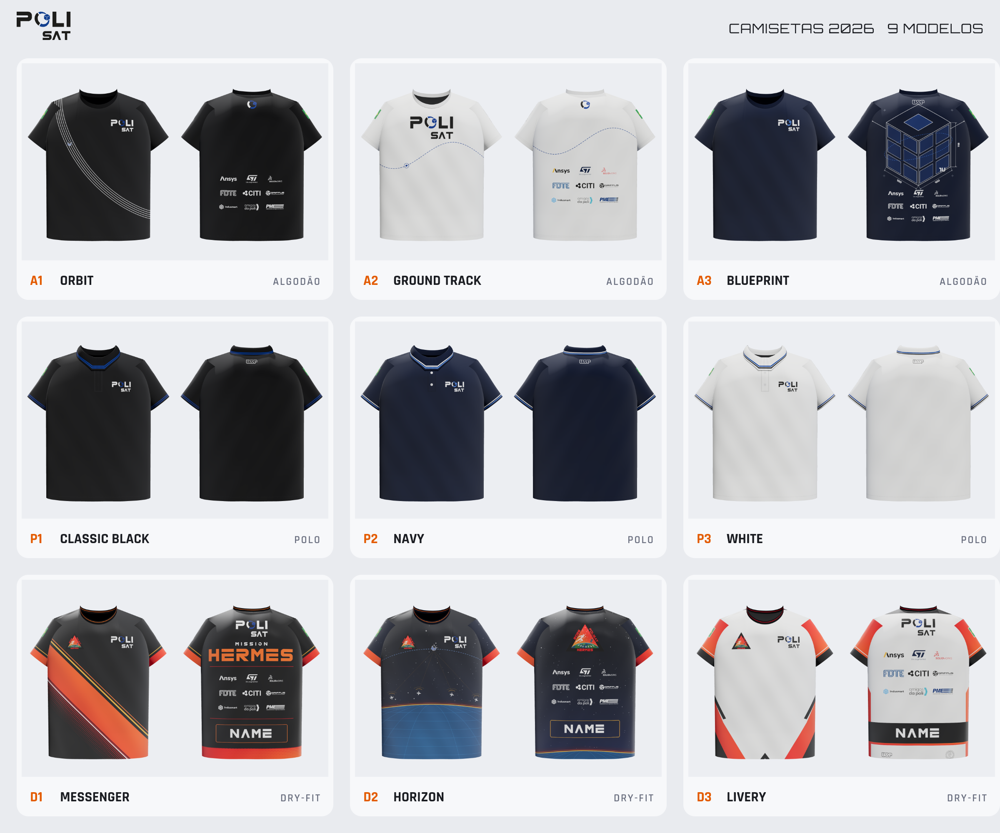

# PoliSat — Camisetas 2026

Nove modelos prontos para a gráfica: **3 polos**, **3 de algodão** e **3 dry-fit**. Todos foram feitos no tamanho M e
estão em escala 1:1.



## Visualizador 3D

O site publicado fica em **<https://polisat-org.github.io/camisetas-3d/>**, no repositório público
[`polisat-org/camisetas-3d`](https://github.com/polisat-org/camisetas-3d). O README de lá explica como acessar,
usar, modificar uma camisa e republicar.

Para conferir localmente, abra `visualizador_3d/index.html` no navegador. Essa pasta é gerada pelo `build.py`.
Depois de mudar um design, copie `index.html` e `dados.js` para o repositório `camisetas-3d` e faça push.

## Modelos

| ID | Modelo | Tecido / cor | Técnica | Patrocinadores | Missão |
|---|---|---|---|---|---|
| P1 | Classic Black | Piquet preto, frisos azul PoliSat | Bordado | — | — |
| P2 | Navy | Piquet azul-marinho, frisos branco + azul claro | Bordado | — | — |
| P3 | White | Piquet branco, frisos azul + preto | Bordado | — | — |
| A1 | Orbit | Algodão 30.1 preto | Silk / DTF | Costas (branco) | — |
| A2 | Ground Track | Algodão 30.1 branco | Silk + DTF | Costas (cor) | — |
| A3 | Blueprint | Algodão 30.1 azul-marinho | Silk / DTF | Costas (branco) | — |
| D1 | Messenger | Dry-fit, sublimação total | Sublimação | Costas | Hermes |
| D2 | Horizon | Dry-fit, sublimação total | Sublimação | Costas | Hermes |
| D3 | Livery | Dry-fit, sublimação total | Sublimação | Costas (cor) | Hermes |

- **Polos e algodão** são atemporais. Levam só os logos da PoliSat, da USP e da Poli e a bandeira do Brasil,
  sem nada da missão. As polos não têm patrocinadores.
- **Dry-fit** são as camisetas da missão Hermes: patch no peito e patrocinadores nas costas. O fim das costas
  é reservado para o **nome** de cada pessoa.
- Todos os textos estão em inglês ("MISSION HERMES", "NAME") e na fonte **ND Logos**, já convertidos em curvas.

## O que levar para a gráfica

Cada pasta em `modelos/<modelo>/` tem:

| Arquivo | Conteúdo |
|---|---|
| `ficha_tecnica_XX.pdf` / `.png` | Ficha técnica A3: vistas com as cotas, tabela de aplicações (tamanho, posição em relação ao HPS, técnica, cores Pantone), tecido, acabamento e observações |
| `impressao/*.svg` + `*.pdf` | **Arquivos de produção** vetoriais em escala 1:1 |
| `mockup_XX_frente/costas/lado.png` | Mockups 3D para aprovação |
| `paineis_visualizacao/` | Painéis completos usados no mockup e no 3D (não são arquivos de produção para polo e algodão) |

- **Algodão / polo:** um arquivo por aplicação, e o nome do arquivo traz o tamanho, por exemplo
  `A1_peito_polisat_105x55mm.pdf`. Logos brancos ficam invisíveis em leitores de PDF com fundo branco. Isso é
  normal: o fundo é transparente.
- **Dry-fit:** painéis inteiros com sangria (frente e costas 600 × 780 mm, mangas 460 × 270 mm), mais
  `costas_sem_nome` para produção, `costas_exemplo_nome` como referência, `nome_editavel.svg`,
  `lista_nomes.csv` e `guias/` com o contorno do molde, a linha central e o HPS.

Os logos normalizados (versões para fundo claro e escuro, e patrocinadores em branco e em cor) estão em
`ativos_vetoriais/`.

## Regenerar / editar

Os designs são código e ficam em `_fonte/`:
- `modelos.py`: os 9 designs;
- `lib.py`: geometria das peças, texto em curvas e logos;
- `viewer_template.html`: o visualizador 3D.

```bash
cd camisetas/_fonte
python3 build.py          # SVGs de impressão, painéis, visualizador 3D, logos
npm install               # 1ª vez (playwright)
npx playwright install chromium
node render.js            # mockups 3D, fichas técnicas, PDFs, comparativo
```

Requisitos: Python 3 com `fonttools` e `pillow`, e Node 18+.

## Observações

- **Patrocinadores** nas costas: Ansys, ST, SolidWorks, FDTE, CITI, Griffus, Indusmart, Amigos da Poli e PME.
  Os arquivos "POLI USP" e "USP" da pasta de patrocinadores não entraram na grade porque USP e Poli já estão
  nas mangas e na nuca.
- O **patch Hermes** só existe em bitmap (PNG 2048 px). A resolução é suficiente para sublimar até cerca de
  30 cm. Se existir uma versão vetorial, vale substituí-la em `_fonte/src/hermes_patch.png`.
- **ND Logos** é uma fonte demo para uso pessoal (dafont). Para uso comercial, fale com os autores.
- As cores Pantone são aproximadas. Peça prova de cor à gráfica.
